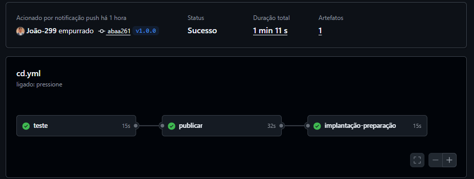
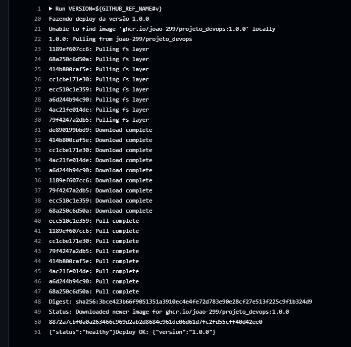
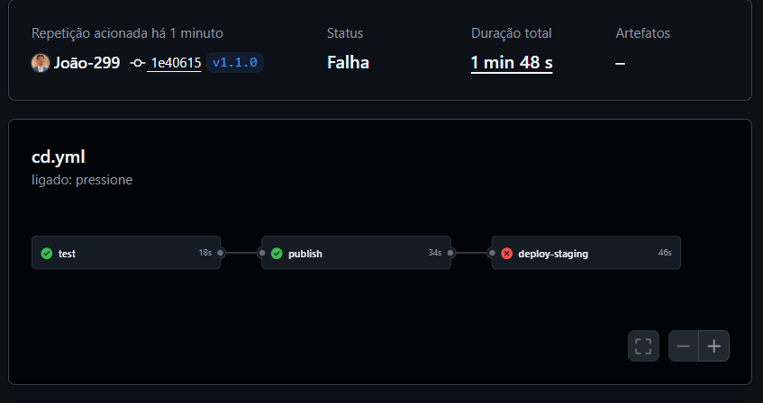
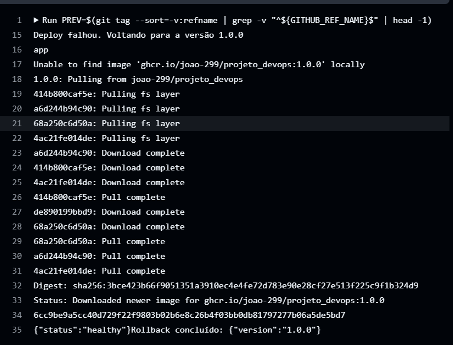
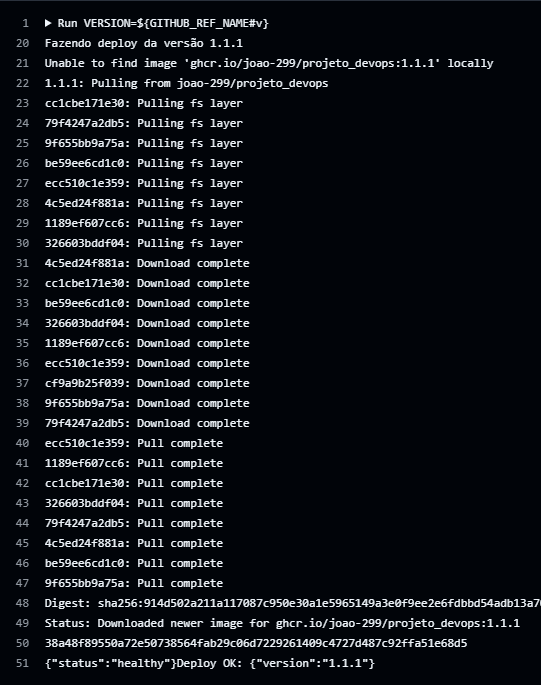
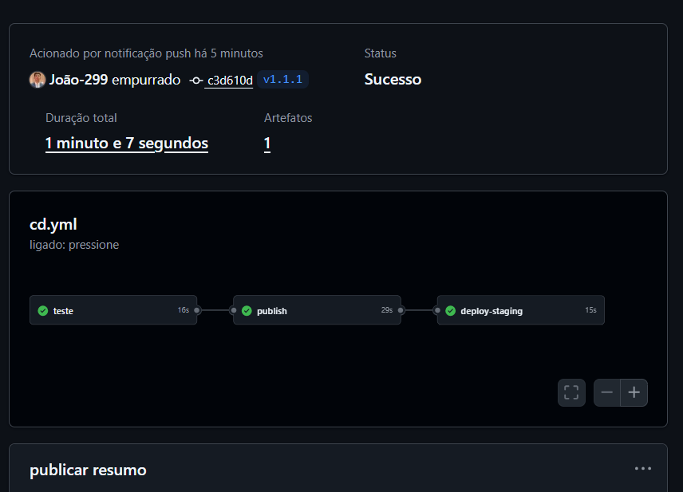
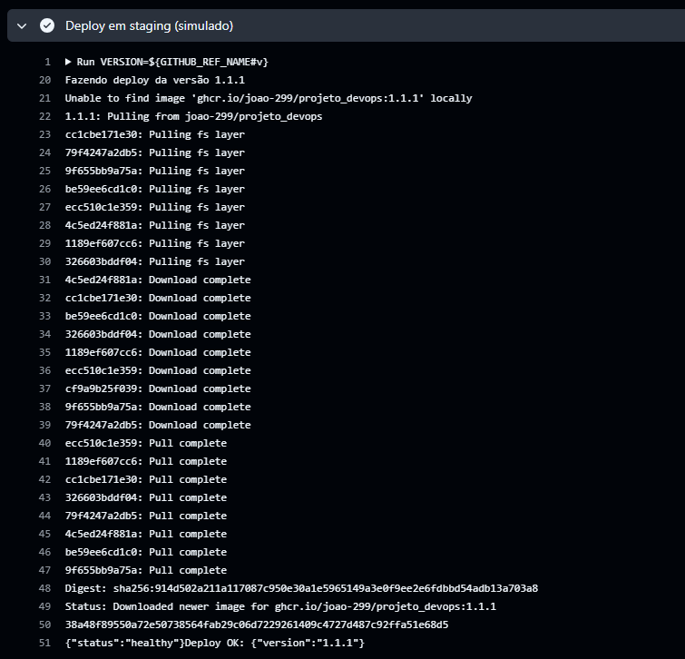
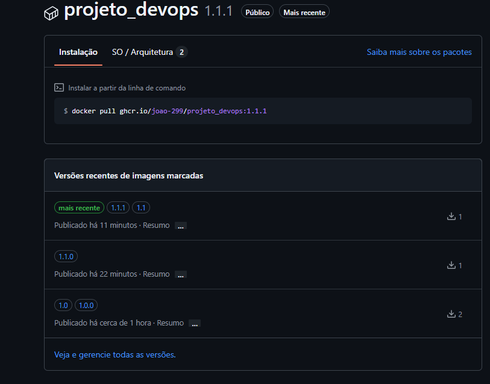

# Versionamento e Rollback

Este documento descreve o versionamento semântico e a demonstração do rollback automático da pipeline de CD.

## Estratégia

- Versionamento semântico com tags `vX.Y.Z`.
- Cada tag dispara o workflow `cd.yml`: testes, publicação da imagem no GHCR e deploy simulado em staging.
- O deploy valida a versão pelo endpoint `/health`. Se falhar, o passo "Rollback automático" sobe a tag estável anterior.
- A falha é provocada de propósito pela variável `SIMULATE_FAILURE`.

## Linha do tempo

| Versão | Situação | O que aconteceu |
|--------|----------|-----------------|
| v1.0.0 | Estável | Pipeline verde. Deploy OK com `{"version":"1.0.0"}`. |
| v1.1.0 | Falhou | Com `SIMULATE_FAILURE=true`, o `/health` retornou 503 e o deploy falhou. |
| Rollback | Automático | A pipeline voltou para a 1.0.0: `Rollback concluído: {"version":"1.0.0"}`. |
| v1.1.1 | Corrigida | Com `SIMULATE_FAILURE=false`, pipeline verde com `{"version":"1.1.1"}`. |

## Evidências

### 1. v1.0.0 estável

### 2. v1.1.0 com falha

### 3. Rollback automático

### 4. v1.1.1 corrigida

### 5. Imagens publicadas no GHCR

## Observações

- O job `deploy-staging` fica vermelho na v1.1.0 mesmo com o rollback funcionando, pois o deploy da nova versão falhou.
- O rollback usa a tag anterior mais recente (`git tag --sort=-v:refname`).
- Problema encontrado: a variável `SIMULATE_FAILURE` estava com uma quebra de linha no final (`"true\n"`), o que impedia a falha de ativar. Foi corrigido regravando o valor sem Enter.